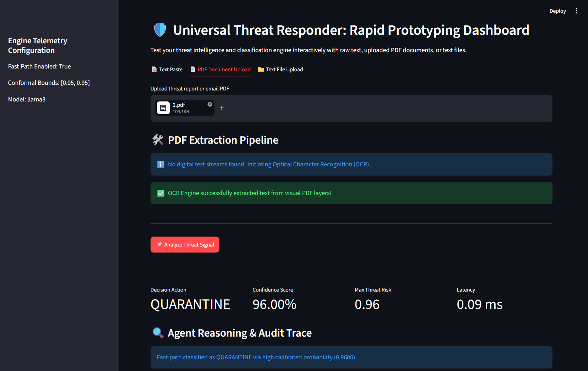
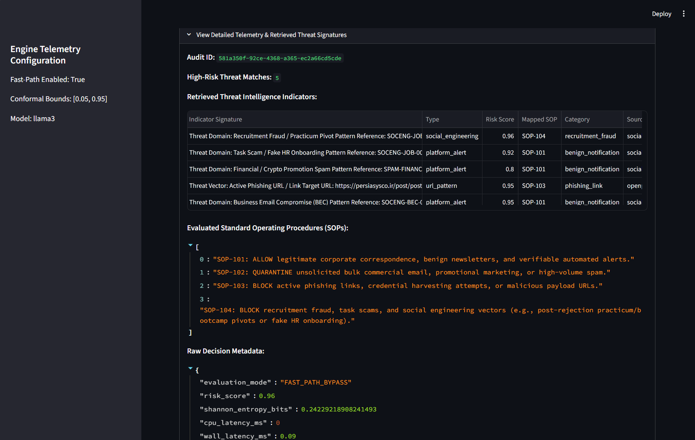

# 🛡️ Universal Threat Responder

### Uncertainty-aware threat triage with RAG, local LLMs, conformal routing, and live threat intelligence

[](https://www.python.org/)
[](https://www.langchain.com/langgraph)
[](https://ollama.com/)
[](https://milvus.io/)
[](https://streamlit.io/)

**Universal Threat Responder** is a research-oriented threat triage and decision engine combining **machine learning, retrieval-augmented generation, local LLM reasoning, conformal risk routing, and live threat intelligence**.

The system accepts heterogeneous threat signals, normalizes them into a common representation, retrieves relevant threat intelligence from a Milvus vector database, and processes the enriched signal through a stateful LangGraph decision workflow.

The default evaluates both the ML model and the LLM on every input. An agreed conformal
singleton may be classified automatically, including VALID when the policy guard permits
it. Disagreements and non-singletons are quarantined for human review. The previous
fast-path policy remains available for historical comparison.

The project also includes an evaluation pipeline for measuring **classification performance, uncertainty, retrieval similarity, calibration, and routing behaviour**.

---

# 🔭 What This Project Demonstrates

The project focuses on the engineering problem of combining **classical ML, retrieval, local LLM reasoning, uncertainty estimation, and operational routing** into one measurable workflow.

The main technical components are:

```text
Machine Learning
    │
    ├── Classification
    ├── Uncertainty estimation
    └── Conformal routing
             │
             ▼
Retrieval
    │
    └── Milvus + embeddings
             │
             ▼
LLM Engineering
    │
    ├── Local inference
    ├── LangGraph
    └── Grounded reasoning
             │
             ▼
Security Engineering
    │
    ├── Threat intelligence
    ├── Document/OCR processing
    └── Audit telemetry
             │
             ▼
Evaluation
    │
    ├── Classification metrics
    ├── Calibration
    ├── Retrieval diagnostics
    └── Routing metrics
```

---

## ✨ Key Features

| Feature                          | Description                                                                    | Technology                           |
| :------------------------------- | :----------------------------------------------------------------------------- | :----------------------------------- |
| **Agentic Threat Triage**        | Stateful threat-analysis workflow producing structured decisions               | LangGraph                            |
| **Local LLM Reasoning**          | Runs the reasoning layer locally without requiring a hosted LLM API            | Ollama / Llama 3                     |
| **Milvus RAG**                   | Retrieves relevant threat indicators, historical patterns, and SOP context     | Milvus + BGE embeddings              |
| **Conformal & Agreement Review** | Quarantines uncertain predictions, model disagreements and guard vetoes        | Split conformal + policy guard       |
| **Live Threat Intelligence**     | Synchronizes current phishing and malicious-URL intelligence before evaluation | OpenPhish, Abuse.ch URLhaus          |
| **PDF & OCR Processing**         | Extracts text from native and scanned PDF documents                            | PyMuPDF, pdfplumber, pypdf, RapidOCR |
| **Domain Adapter Architecture**  | Separates domain-specific data loading from the core decision graph            | `DomainAdapter`                      |
| **Leakage-Aware Evaluation**     | Uses grouped stratification and checks for exact duplicates                    | StratifiedGroupKFold                 |
| **Telemetry & Audit Logging**    | Records prediction, uncertainty, retrieval, routing, and operational metrics   | CSV / logs                           |
| **Interactive Dashboard**        | Allows interactive analysis of text, files, and PDFs                           | Streamlit                            |

---

# 🏗️ System Architecture

```text
Email / document
  -> calibrated ML prediction + conformal set
  -> Milvus retrieval + local LLM classification
  -> agreement review
       -> matching singleton and no guard veto: VALID, SPAM or PHISHING
       -> disagreement / non-singleton / guard veto / failure: QUARANTINE
  -> audit log + up to 3 relevant retrieved policy patterns
```

VALID decisions are automatically allowed only on agreement with a VALID singleton and
when the policy guard does not veto them. This does not guarantee zero leaks.
QUARANTINE is a conservative status, not a fully implemented human-review queue: the prototype records an
audit entry and displays the retrieved patterns, but does not manage analyst approvals.
Fewer than three patterns may be shown if retrieval finds fewer relevant matches. The LLM
prompt includes the ML prediction, so model agreement is not statistically independent.

---

## Project Structure

```text
universal-threat-responder/
├── adapters/
│   ├── __init__.py
│   ├── phishfuzzer_loader.py            # Zero-leakage dataset loader & TF-IDF vectorization
│   └── rag_spam_adapter.py              # Milvus Vector RAG Adapter
├── data/
│   ├── milvus_threat_intel.db/          # Persistent Milvus Lite vector database
│   └── spam/                            # Evaluation benchmark datasets
├── evals/
│   ├── __init__.py
│   ├── results/                         # Historical, experimental and new run outputs
│   ├── run_evals.py                     # Main evaluation runner with threat-intel sync
│   └── threat_evaluator.py              # Uncertainty & evaluation metrics
├── scripts/
│   ├── update_readme_results.py         # Refreshes benchmark_results.md from latest eval CSVs
│   ├── ingest_threat_intel.py           # Threat intelligence ingestion
│   └── populate_phishing_vectorstore.py # Indexes threat patterns into Milvus
├── src/
│   ├── __init__.py
│   ├── core.py                          # ThreatResponderGraph & SecurityTools
│   ├── domain_interface.py              # ThreatSignal, DecisionOutput, DomainAdapter
│   └── input_parsers.py                  # JSON and CSV batch input parsers
├── tests/
│   ├── test_core.py                     # Decision routing, enforcement, and audit behavior
│   ├── test_evaluator.py                 # Uncertainty and hallucination telemetry
│   ├── test_high_risk_policy_guard.py    # High-risk VALID override protection
│   ├── test_input_parsers.py             # JSON and CSV input parsing
│   └── test_rag_adapter.py               # Retrieval context and entropy calculations
├── app.py                               # Streamlit dashboard entry point
├── benchmark_results.md                 # Benchmark & telemetry results
├── config.py                            # Configuration & conformal bounds
├── requirements.txt                     # Dependencies
└── README.md                            # Project documentation
```

---

## Interactive Dashboard & Execution Example

The Streamlit prototyping dashboard (`app.py`) allows you to analyze threat signals interactively using raw text, text files, or uploaded PDF documents.

### Dashboard UI Preview

<p align="center">
  
  
</p>

For scanned PDFs, the extraction pipeline falls back to OCR when digital text is unavailable.

---

## Benchmark & Telemetry Results

The historical 2026-11-02 runs used 3,960 PhishFuzzer samples each. With fast-path enabled,
coverage was 94.4%, resolved accuracy 93.0%, and leak rate 2.8%. With it disabled,
coverage was 83.7%, resolved accuracy 94.0%, and leak rate 1.3%. These use the old policy,
not the current agreement-review policy.

On the disabled run, the ML-only conformal baseline decided 87.8% of samples with 94.7%
accuracy on those decisions. This is a historical dataset-specific result, not a guarantee.
Replaying the agreement policy on those historical outputs yields 75.8% coverage, 97.1%
resolved accuracy and a 0.6% leak rate; it is a counterfactual, not a new end-to-end run.

The 2026-11-09 agreement-review run (`20261109_172140_227716`, 3,960 samples,
fold 0, alpha 0.05) evaluated both ML and the LLM. All samples took the RAG/LLM
route; only agreeing, unambiguous predictions were decided automatically.

| System | Coverage | Resolved accuracy | End-to-end accuracy | Leak rate | False-block rate |
|---|---:|---:|---:|---:|---:|
| ML only | 100.0% | 90.6% | 90.6% | 4.6% | 13.4% |
| ML + conformal | 87.8% | 94.7% | 83.1% | 2.2% | 6.9% |
| Agreement review + RAG/LLM | 75.8% | 97.0% [96.4, 97.6] | 73.6% [72.2, 75.0] | 0.6% | 3.8% |

The full system had higher accuracy among decided samples, but quarantined more
samples, lowering end-to-end accuracy. Results are specific to this dataset, split,
model, and configuration.

In short, 97.0% resolved accuracy applies only to the 75.8% of samples handled
without quarantine; end-to-end accuracy was 73.6% when quarantines count as unresolved.
Reporting both outcomes, along with the run settings and data provenance, makes the
trade-off visible and helps prevent selective interpretation of benchmark results.

See **[benchmark_results.md](benchmark_results.md)** for the full performance summary, confusion matrices, telemetry, and data provenance.

---

# 🗺️ Roadmap

### Evaluation

- [ ] Formalize reproducible dependency versions
- [ ] Add automated CI regression evaluation
- [ ] Expand ablation studies
- [ ] Further calibrate conformal thresholds
- [ ] Evaluate routing quality independently from classification quality

### Retrieval

- [ ] Add sender-domain telemetry
- [ ] Add SPF/DKIM signals
- [ ] Add URL link-entropy features
- [ ] Expand the SOP knowledge base

### Security domains

- [ ] Network intrusion / SIEM adapter
- [ ] NetFlow analysis adapter
- [ ] Transaction-fraud adapter
- [ ] MITRE ATT&CK mapping

### Human oversight

- [ ] Uncertainty-based analyst escalation
- [ ] Human-in-the-loop review queue
- [ ] Analyst feedback collection
- [ ] Review and override telemetry

---

## Setup & Quickstart

### Prerequisites

- Python 3.10+
- [Ollama](https://ollama.com/) installed and running locally
- Llama 3 (the default in `config.py`)

```bash
ollama pull llama3
```

Keep Ollama running while using the evaluator or dashboard. If Ollama is not
already running as a background service, open a separate terminal and start it:

```bash
ollama serve
```

Leave that terminal open. Run the evaluation or dashboard commands below from
another terminal.

### Clone & Set Up Environment

```bash
git clone https://github.com/Aylin1/universal-threat-responder.git
cd universal-threat-responder

# Linux / macOS
python3 -m venv .venv
source .venv/bin/activate

# Windows Git Bash
python -m venv .venv
source .venv/Scripts/activate
```

```powershell
# Windows PowerShell
python -m venv .venv
.\.venv\Scripts\Activate.ps1
```

### Install Dependencies

```bash
pip install -r requirements.txt
```

### Run Tests

After activating the virtual environment and installing dependencies:

```bash
python -m pytest
```

Unit tests do not require Ollama or a populated vector store.

### 1. Run Evaluation — Agreement Review (Default)

Ensure Ollama is running (`ollama serve` in a separate terminal if needed), then
populate the matching history index:

```bash
python scripts/populate_phishing_vectorstore.py
```

```bash
python -m evals.run_evals
```

### 2. Run Historical Policy Comparisons

```bash
python -m evals.run_evals --legacy-policy --enable-fast-path
python -m evals.run_evals --legacy-policy --disable-fast-path
```

Each new evaluation creates a separate, git-ignored run folder:

```text
evals/results/runs/<mode>_<run_id>/
├── live_audit_report_results_<mode>_<run_id>.csv
├── live_audit_report_results_<mode>_<run_id>.md
├── metadata.json
└── audit.jsonl
```

The CSV records `ml_prob_valid`, the LLM's self-reported `llm_confidence`, and
`llm_confidence_source`. The latter flags when a missing or invalid confidence was
replaced by the parser's default. LLM confidence describes its predicted class, not
necessarily VALID, and is not a calibrated probability. Multiple draws report the
mean confidence of the winning votes. Values are blank if no LLM ran.

The metadata records the actual fitted classifier and vectorizer parameters, conformal
calibration, LLM settings, dataset and IOC snapshot hashes, split, retrieval/guard
settings and package versions. The Ollama model digest is not captured, so the model
tag alone does not establish an immutable model version. Existing reports are in
`evals/results/historical/`, and experimental results are in `evals/results/experiments/`;
unavailable historical parameters are not inferred.
Run files and audit logs can contain sensitive evaluation information; inspect them
before sharing or committing them.

After running evaluations, refresh [benchmark_results.md](benchmark_results.md) from the latest report of each mode:

```bash
python -m scripts.update_readme_results
```

Replay the agreement policy on a complete historical disabled run without calling the LLM:

```bash
python -m evals.sweep_guard evals/results/historical/live_audit_report_results_fastpath-disabled_20261102_222648_585601.csv --agreement-review
```

The legacy guard sweep tunes a veto on LLM VALID decisions; its results do not directly
tune the agreement policy, which also quarantines disagreements and non-singletons.
Guard thresholds remain defaults and should be selected on development data and validated
on a separate held-out split before use.

### 3. Launch the Interactive Dashboard

```bash
streamlit run app.py
```

---

## Notes

This project is a **research/engineering prototype** for experimenting with retrieval-grounded threat triage, conformal routing, local LLMs, and auditable security workflows. Benchmark results are dataset- and configuration-specific and should not be interpreted as production security performance.
