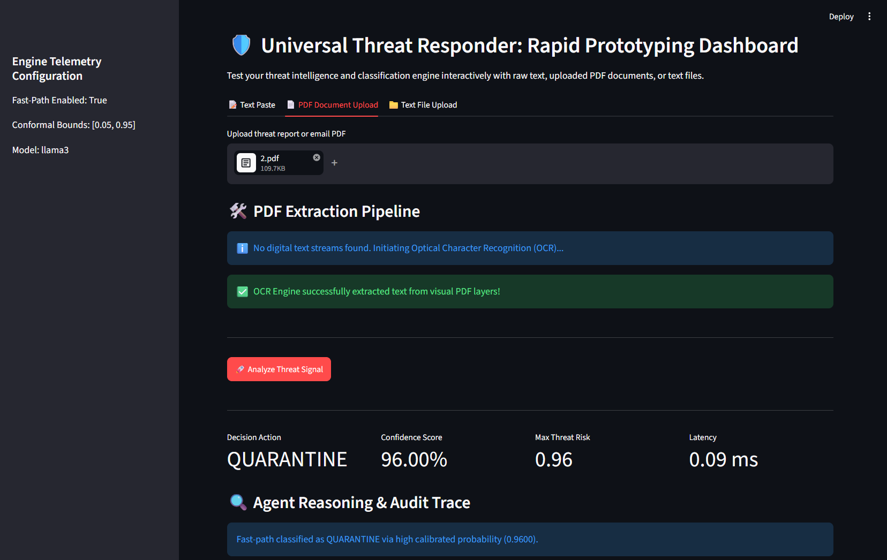
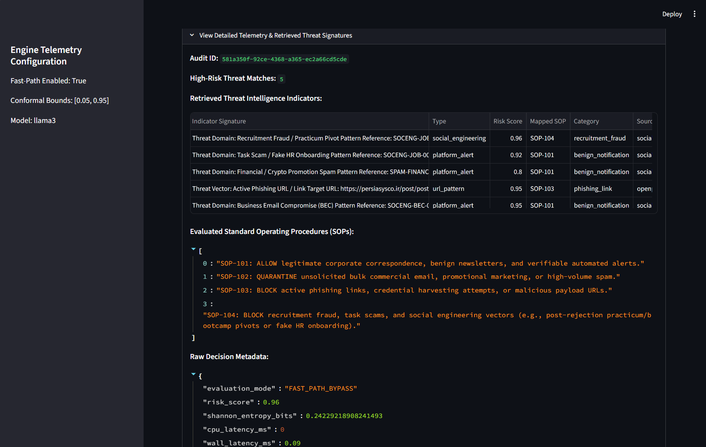

# 🛡️ Universal Threat Responder

### Uncertainty-aware threat triage with RAG, local LLMs, conformal routing, and live threat intelligence

[](https://www.python.org/)
[](https://www.langchain.com/langgraph)
[](https://ollama.com/)
[](https://milvus.io/)
[](https://streamlit.io/)

**Universal Threat Responder** is a research-oriented threat triage and decision engine combining **machine learning, retrieval-augmented generation, local LLM reasoning, conformal risk routing, and live threat intelligence**.

The dashboard combines a saved classifier, live threat-feed checks, Milvus retrieval,
and a local LLM in a stateful LangGraph workflow. Both the dashboard and evaluation
retrieve similar historical emails and policy patterns.

The default evaluates successfully processed inputs with both the ML model and the LLM.
An agreed conformal singleton may be classified automatically, including VALID when the
policy guard permits it. Disagreements and non-singletons are quarantined for human review.
The previous fast-path policy remains available for historical comparison.

The project also includes an evaluation pipeline for measuring **classification performance, uncertainty, retrieval similarity, calibration, and routing behaviour**.

---

# 🔭 What This Project Demonstrates

The project focuses on the engineering problem of combining **classical ML, retrieval, local LLM reasoning, uncertainty estimation, and operational routing** into one measurable workflow.

The main technical components are:

```text
Machine Learning
    │
    ├── Classification
    ├── Uncertainty estimation
    └── Conformal routing
             │
             ▼
Retrieval
    │
    └── Milvus + embeddings
             │
             ▼
LLM Engineering
    │
    ├── Local inference
    ├── LangGraph
    └── Grounded reasoning
             │
             ▼
Security Engineering
    │
    ├── Threat intelligence
    ├── Document/OCR processing
    └── Audit telemetry
             │
             ▼
Evaluation
    │
    ├── Classification metrics
    ├── Calibration
    ├── Retrieval diagnostics
    └── Routing metrics
```

---

## ✨ Key Features

| Feature                          | Description                                                                    | Technology                           |
| :------------------------------- | :----------------------------------------------------------------------------- | :----------------------------------- |
| **Agentic Threat Triage**        | Stateful threat-analysis workflow producing structured decisions               | LangGraph                            |
| **Local LLM Reasoning**          | Runs the reasoning layer locally without requiring a hosted LLM API            | Ollama / Llama 3                     |
| **Milvus RAG**                   | Retrieves historical emails and policy patterns for dashboard and evaluation   | Milvus + BGE embeddings              |
| **Conformal & Agreement Review** | Quarantines uncertain predictions, model disagreements and guard vetoes        | Split conformal + policy guard       |
| **Live Threat Intelligence**     | Checks URLs against refreshed phishing and malicious-URL feeds                 | OpenPhish, Abuse.ch URLhaus          |
| **PDF & OCR Processing**         | Extracts text from native and scanned PDF documents and PNG images             | PyMuPDF, pdfplumber, pypdf, RapidOCR |
| **Domain Adapter Architecture**  | Separates domain-specific data loading from the core decision graph            | `DomainAdapter`                      |
| **Leakage-Aware Evaluation**     | Uses grouped stratification and checks for exact duplicates                    | StratifiedGroupKFold                 |
| **Telemetry & Audit Logging**    | Records prediction, uncertainty, retrieval, routing, and operational metrics   | CSV / logs                           |
| **Interactive Dashboard**        | Allows interactive analysis of text, files, and PDFs                           | Streamlit                            |

---

# 🏗️ System Architecture

```text
Email / document
  -> calibrated ML prediction + conformal set
  -> threat-feed checks + Milvus retrieval + local LLM classification
  -> agreement review
       -> matching singleton and no guard veto: VALID, SPAM or PHISHING
       -> disagreement / non-singleton / guard veto / LLM failure: QUARANTINE
  -> audit log
```

VALID decisions are automatically allowed only on agreement with a VALID singleton and
when the policy guard does not veto them. This does not guarantee zero leaks.
QUARANTINE is a conservative status, not a fully implemented human-review queue: the prototype records an
audit entry, but does not manage analyst approvals. The LLM prompt includes the ML prediction,
so model agreement is not statistically independent. Input or retrieval errors before
the decision workflow are reported as errors in the dashboard.

---

## Project Structure

Key files and folders (generated runtime data and evaluation results may vary):

```text
universal-threat-responder/
├── adapters/
│   ├── phishfuzzer_loader.py          # Dataset splits and classifier
│   └── rag_spam_adapter.py            # Retrieval and spam-domain adapter
├── data/
│   └── spam/                          # PhishFuzzer datasets
├── docs/
│   └── architecture.md
├── evals/
│   ├── run_evals.py                   # Evaluation runner
│   └── sweep_guard.py                 # Historical policy replay
├── example_screenshots/               # Dashboard previews
├── models/
│   └── phishfuzzer_classifier.joblib  # Saved dashboard classifier
├── rag_index/                         # Prebuilt dashboard retrieval index
├── scripts/                           # Launching, ingestion and indexing
├── src/                               # Decision workflow and supporting logic
├── tests/                             # Automated tests
├── app.py                             # Streamlit dashboard
├── benchmark_results.md               # Benchmark summary
├── compose.yaml                       # Docker services
├── config.py                          # Application settings
├── Dockerfile                         # Dashboard image
├── requirements.txt                   # Python dependencies
├── start-dashboard-docker.sh          # Docker launcher for Linux/macOS
└── start-dashboard.cmd                # Windows launcher
```

---

## Interactive Dashboard & Execution Example

The Streamlit prototyping dashboard (`app.py`) allows you to analyze threat signals interactively using raw text, text files, HTML, or uploaded PDF and PNG documents.

### Dashboard UI Preview

<p align="center">
  
  
</p>

For scanned PDFs, the extraction pipeline falls back to OCR when digital text is unavailable. PNG uploads use OCR to extract text; non-text visual details are not analyzed.

---

## Benchmark & Telemetry Results

The historical 2026-11-02 runs used 3,960 PhishFuzzer samples each. With fast-path enabled,
coverage was 94.4%, resolved accuracy 93.0%, and leak rate 2.8%. With it disabled,
coverage was 83.7%, resolved accuracy 94.0%, and leak rate 1.3%. These use the old policy,
not the current agreement-review policy.

On the disabled run, the ML-only conformal baseline decided 87.8% of samples with 94.7%
accuracy on those decisions. This is a historical dataset-specific result, not a guarantee.
Replaying the agreement policy on those historical outputs yields 75.8% coverage, 97.1%
resolved accuracy and a 0.6% leak rate; it is a counterfactual, not a new end-to-end run.

One local 2026-11-09 agreement-review run (`20261109_172140_227716`, 3,960 samples,
fold 0, alpha 0.05) evaluated both ML and the LLM. All samples took the RAG/LLM
route; only agreeing, unambiguous predictions were decided automatically.

| System                     | Coverage |  Resolved accuracy | End-to-end accuracy | Leak rate | False-block rate |
| -------------------------- | -------: | -----------------: | ------------------: | --------: | ---------------: |
| ML only                    |   100.0% |              90.6% |               90.6% |      4.6% |            13.4% |
| ML + conformal             |    87.8% |              94.7% |               83.1% |      2.2% |             6.9% |
| Agreement review + RAG/LLM |    75.8% | 97.0% [96.4, 97.6] |  73.6% [72.2, 75.0] |      0.6% |             3.8% |

The full system had higher accuracy among decided samples, but quarantined more
samples, lowering end-to-end accuracy. Results are specific to this dataset, split,
model, and configuration. The dashboard loads a saved classifier and prebuilt index,
so these results are not a direct measurement of its current configuration.

In short, 97.0% resolved accuracy applies only to the 75.8% of samples handled
without quarantine; end-to-end accuracy was 73.6% when quarantines count as unresolved.
Reporting both outcomes, along with the run settings and data provenance, makes the
trade-off visible and helps prevent selective interpretation of benchmark results.

The checked-in [benchmark summary](benchmark_results.md) is an older snapshot and does
not include this agreement-review run. Detailed reports are stored under the git-ignored
`evals/results/` directory and may not be present in a fresh checkout. Refresh the
summary with `python -m scripts.update_readme_results` when reports are available locally.

---

## Dashboard Setup & Quickstart

### Docker: use your existing Ollama (recommended)

1. Install and start [Docker Desktop](https://www.docker.com/products/docker-desktop/)
   (or Docker Engine with Compose on Linux).
2. Install and start [Ollama](https://ollama.com/). If it is not already running,
   open Ollama or run `ollama serve` in another terminal.
3. From the repository folder, run (on Linux Docker Engine, see the note below first):

   ```bash
   docker compose up
   ```

4. Open [http://localhost:8501](http://localhost:8501). Press **Ctrl+C** in the
   terminal to stop the dashboard.

The dashboard uses your host Ollama and its existing `llama3` model; if that model
is missing, it downloads it to the host. GPU use is managed by host Ollama. Docker
does not start the host Ollama server or open the browser itself.

The first run builds the image. When you first open the dashboard, it fetches fresh
threat feeds and prepares the prebuilt RAG index. It uses the saved classifier and does
not train or index PhishFuzzer. The embedding model may download on first use.
Feeds refresh once per server startup; if no fresh indicators can be fetched, the
dashboard reports an error. The prebuilt index contains training-email text, so
review it before sharing.

**Open the browser automatically:**

- Windows PowerShell:

  ```powershell
  docker compose up --wait dashboard; if ($?) { start http://localhost:8501 }
  ```

- Linux or macOS:

  ```bash
  bash start-dashboard-docker.sh
  ```

  The launcher uses `open` on macOS or `xdg-open` on Linux. If it cannot open a
  browser, use the displayed URL. Both automatic options leave the dashboard running;
  stop it with `docker compose stop dashboard`.

<details>
<summary>Linux Docker Engine, other Docker options and troubleshooting</summary>

**Linux Docker Engine:** The Bash launcher selects the Docker host gateway. The host
Ollama server must listen on an address reachable from the Docker bridge, not just
loopback. For example, set Ollama's `OLLAMA_HOST` to `0.0.0.0:11434` and restart it,
then restrict access with firewall rules. This exposes the unauthenticated Ollama API
beyond localhost; do not use it on an untrusted network without protection. Docker
Desktop uses its built-in host address instead. To use `docker compose up` directly
with Linux Docker Engine, first run `export DASHBOARD_OLLAMA_ADDRESS=docker-host-gateway`.

#### Alternative: run Ollama in Docker

Choose this if you want Docker to run Ollama too; no host Ollama installation is
required. Docker downloads a **separate model copy** into a persistent volume, so
the first start takes more time and disk space.

Stop the host-backed dashboard first with `docker compose stop dashboard`, then run:

```bash
docker compose up dashboard-container
```

Open [http://localhost:8501](http://localhost:8501). For an NVIDIA GPU supported
by Docker, use `docker compose up dashboard-container-gpu` instead. GPU support
requires an NVIDIA driver and Docker GPU support; insufficient free GPU memory may
cause Ollama to use the CPU.

Only run one dashboard option at a time: they share a port and data volumes. Before
switching back, stop the containerized option with
`docker compose stop dashboard-container ollama` (or
`docker compose stop dashboard-container-gpu ollama-gpu` for GPU). The model volume
is retained. The containerized Ollama API is not published to the host network.

#### Docker tips

- **Rebuild after code changes:** `docker compose up --build`
- **View startup logs:** `docker compose logs -f dashboard`; for containerized
  Ollama, use `docker compose --profile container-ollama logs -f dashboard-container ollama`.
- **Change the port:** set `DASHBOARD_PORT` before starting, then open that port.
  For example, in PowerShell: `$env:DASHBOARD_PORT = "8503"`.
- Docker volumes retain the containerized Ollama model, retrieval index, embedding
  model cache, feed snapshots and logs.
  The saved classifier is copied into a new volume on first use; rebuilding does not
  replace that copy.
  Do not use `docker compose down -v` unless you intend to delete the volumes.

Running a local model means prompts need not be sent to a cloud model provider, but
it is not a security guarantee: dashboard data and logs can be sensitive. Setup and
threat-feed refresh use the internet; remote or cloud models have different privacy
properties. Streamlit usage statistics are disabled for Docker.

</details>

### Windows: one-click alternative

Install [Ollama](https://ollama.com/), then double-click `start-dashboard.cmd` in
the repository folder. Keep its window open while using the dashboard.

The launcher reuses an existing Python 3.11 environment or creates one, installs
dependencies, and starts Ollama if needed. First-time downloads may take a while.
If `winget` is unavailable or installation fails, install Python 3.11 and try again.
Only load trusted classifier files: joblib deserialization can execute code.

<details>
<summary>Manual Python setup (optional)</summary>

Run commands from the repository root.

### 1. Install prerequisites

- Python 3.11 is recommended for the included classifier.
- Install [Ollama](https://ollama.com/).
- An internet connection is needed to install dependencies, download the LLM, and
  refresh threat feeds each time the dashboard starts.

### 2. Clone and set up Python

```bash
git clone https://github.com/Aylin1/universal-threat-responder.git
cd universal-threat-responder

# Linux / macOS
python3 -m venv .venv
source .venv/bin/activate

# Windows Git Bash
python -m venv .venv
source .venv/Scripts/activate
```

```powershell
# Windows PowerShell
python -m venv .venv
.\.venv\Scripts\Activate.ps1
```

Install the dependencies and the versions required by the included classifier:

```bash
python -m pip install -r requirements.txt scikit-learn==1.9.0 xgboost==3.2.0
```

### 3. Start the local language model

```bash
ollama serve
# In a second terminal:
ollama pull llama3
```

Keep Ollama running. If it is already running as a background service, skip
`ollama serve`.

### 4. Launch and use the dashboard

```bash
streamlit run app.py
```

Open the address printed by Streamlit. Paste an email and select **Analyze Threat
Signal(s)**, or upload a PDF, PNG, JSON, CSV, TXT, or HTML file. New uploads are
analyzed automatically. Expand a result to see the ML prediction, conformal set, LLM
prediction and threat-feed hits. `QUARANTINE` means review is needed; it is
not a completed analyst workflow or a guarantee of safety.

PDFs use OCR when no digital text is found; PNGs use OCR. HTML is parsed as text without
running scripts or loading remote resources; link and form destinations are included.
Inputs and audit output may contain sensitive information.

The dashboard fetches fresh feeds when its first browser session starts. OpenPhish is
used by default; URLhaus is optional and requires `URLHAUS_AUTH_KEY`. If no feed returns
indicators, the dashboard reports an error rather than silently using an old snapshot.

The app loads the saved classifier rather than training at startup. Only load trusted
joblib files: deserialization can execute code. If its required package versions do
not match, install the versions above or rebuild it with your installed versions:

```bash
python -m scripts.build_classifier
```

Rebuilding also supports Python 3.10. Restart Streamlit afterward to clear its cache.

</details>

---

# 🗺️ Roadmap

### Evaluation

- [x] Compare ML-only and ML + conformal baselines and historical fast-path policies
- [x] Calibrate split-conformal thresholds on a held-out calibration split
- [x] Report coverage and outcomes by route
- [x] Configure CI for focused unit and policy regression tests
- [ ] Formalize reproducible dependency versions
- [ ] Add automated CI regression evaluation
- [ ] Expand ablation studies
- [ ] Further calibrate conformal thresholds
- [ ] Evaluate routing quality independently from classification quality

### Retrieval

- [ ] Add sender-domain telemetry
- [ ] Add SPF/DKIM signals
- [ ] Add URL link-entropy features
- [ ] Expand the SOP knowledge base

### Security domains

- [ ] Network intrusion / SIEM adapter
- [ ] NetFlow analysis adapter
- [ ] Transaction-fraud adapter
- [ ] MITRE ATT&CK mapping

### Human oversight

- [x] Quarantine uncertain or conflicting predictions and record audit entries
- [ ] Uncertainty-based analyst escalation
- [ ] Human-in-the-loop review queue
- [ ] Analyst feedback collection
- [ ] Review and override telemetry

Quarantine records a status and audit entry; it does not yet deliver cases to an analyst queue.

---

## Advanced: Evaluation & Development

These commands are optional and are intended for experimentation and benchmarking.

### Tests

```bash
python -m pytest
```

Unit tests do not require Ollama or a populated vector store. CI runs a focused subset
of unit and policy regression tests; it does not run the end-to-end evaluation.

### Agreement-review evaluation

For retrieval-based evaluation, prepare the separate Milvus collections and keep Ollama
running. These commands use the PhishFuzzer dataset and can take time:

```bash
python scripts/ingest_threat_intel.py
python scripts/populate_phishing_vectorstore.py
python -m evals.run_evals
```

Stop other processes using the same Milvus database before indexing or evaluating.
Avoid running the dashboard simultaneously with an evaluation that uses the same feed
snapshot, because the dashboard refreshes it at startup.

### Historical policy comparisons

```bash
python -m evals.run_evals --legacy-policy --enable-fast-path
python -m evals.run_evals --legacy-policy --disable-fast-path
```

Each evaluation writes a CSV, report, metadata and audit log to a separate,
git-ignored folder under `evals/results/runs/`.

The CSV records `ml_prob_valid`, the LLM's self-reported `llm_confidence`, and
`llm_confidence_source`. The latter flags when a missing or invalid confidence was
replaced by the parser's default. LLM confidence describes its predicted class, not
necessarily VALID, and is not a calibrated probability. Multiple draws report the
mean confidence of the winning votes. Values are blank if no LLM ran.

The metadata records the actual fitted classifier and vectorizer parameters, conformal
calibration, LLM settings, dataset and IOC snapshot hashes, split, retrieval/guard
settings and package versions. The Ollama model digest is not captured, so the model
tag alone does not establish an immutable model version. Locally available historical
reports are in `evals/results/historical/`, and experimental results are in
`evals/results/experiments/`. These files are git-ignored and may not be present in a
fresh checkout; unavailable historical parameters are not inferred.
Run files and audit logs can contain sensitive evaluation information; inspect them
before sharing or committing them.

The dashboard uses a separate prebuilt copy of the historical-email and policy-pattern
index. Evaluation still fits its own classifier and validates its own history split, so
the published evaluation results should not be treated as dashboard performance.

Replay the agreement policy on a complete historical disabled run without calling the LLM:

```bash
python -m evals.sweep_guard evals/results/historical/live_audit_report_results_fastpath-disabled_20261102_222648_585601.csv --agreement-review
```

The legacy guard sweep tunes a veto on LLM VALID decisions; its results do not directly
tune the agreement policy, which also quarantines disagreements and non-singletons.
Guard thresholds remain defaults and should be selected on development data and validated
on a separate held-out split before use.

The included dashboard classifier was trained on 12,672 emails, with 3,168 held out
for conformal calibration (fold 0, seed 42). It contains a TF-IDF vectorizer,
classifier and conformal router.

---

## Notes

This project is a **research/engineering prototype** for experimenting with retrieval-grounded threat triage, conformal routing, local LLMs, and auditable security workflows. Benchmark results are dataset- and configuration-specific and should not be interpreted as production security performance.
