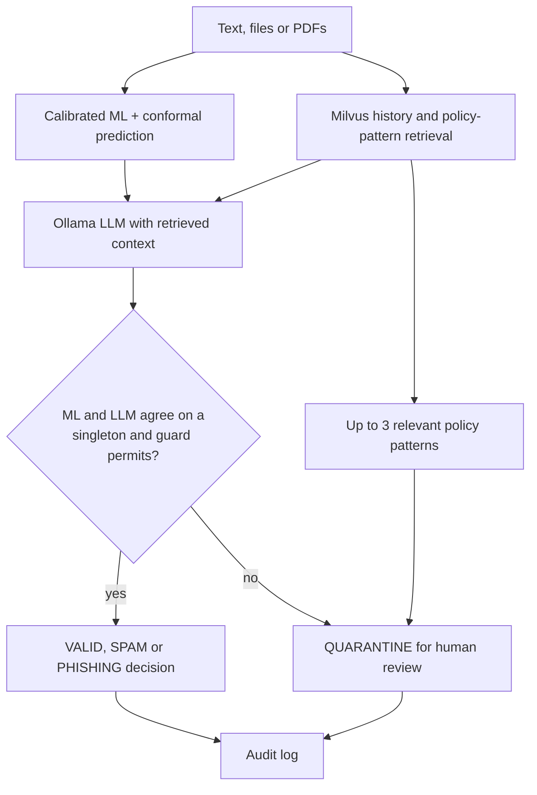

# Architecture & flow

## Default agreement-review workflow

The default dashboard and evaluation run use both models. Empty or multi-label conformal
sets, disagreements, guard vetoes and failures are quarantined. An agreed VALID singleton
can be automatically allowed; this does not guarantee zero leaks. Exact IOC hits
are also reviewed when the final classification is not PHISHING. The LLM prompt includes
the ML prediction; agreement does not imply independent evidence. The graph logs actions
but does not actually deliver, block or isolate email, nor does it provide an analyst queue.

The dashboard fits the classifier on the configured PhishFuzzer split at startup. The
classifier and conformal router are not a general-purpose trained production model. Raw
inputs without recognizable email headers are treated as body text; missing sender,
link and attachment fields limit the available structural features.

Policy patterns are the highest-similarity entries from the pattern collection above the
relevance cutoff. The dashboard displays at most three; fewer or none can be returned.
The full static SOP list remains available in the LLM prompt.

## Historical comparison mode

The legacy graph supports an IOC bypass, singleton fast-path routing, and RAG/LLM
escalation with an asymmetric VALID veto. Run it explicitly with `--legacy-policy`.
Legacy results and the agreement-review policy should not be pooled as one experiment.

## Evaluation

`PhishFuzzerDatasetAdapter` uses group-aware proper-training, calibration and test splits.
The evaluation runner checks that the retrieval-history index matches the split, then
records decisions, ML probabilities, conformal sets, retrieval and latency telemetry.
Each new run stores its CSV, report, audit log and model/configuration metadata in a
git-ignored `evals/results/runs/<mode>_<run_id>/` folder. Historic reports are in
`evals/results/historical/` and experimental outputs are in `evals/results/experiments/`.
Use `scripts/update_readme_results.py` to select the newest timestamped result separately
for each policy mode. Review [benchmark_results.md](../benchmark_results.md) for run IDs,
metrics and links to the full reports.

Agreement-review replay of a historical fast-path-disabled CSV is a counterfactual using
the stored LLM output and prior guard outcome, not a new inference run. The old guard
sweep tunes only the historical LLM VALID veto; it does not evaluate the complete
agreement policy.
