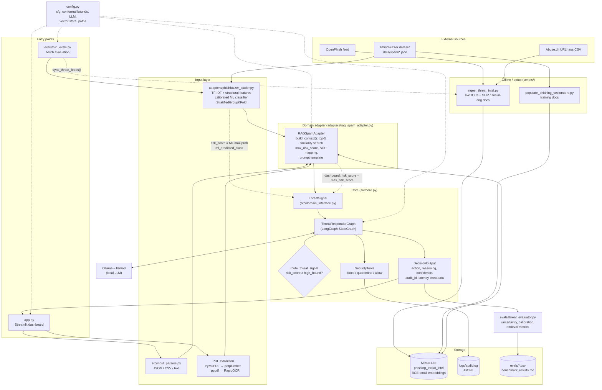
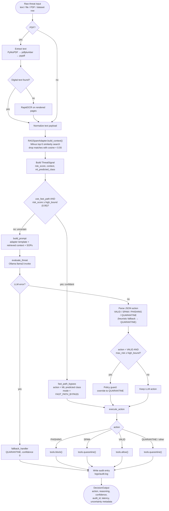
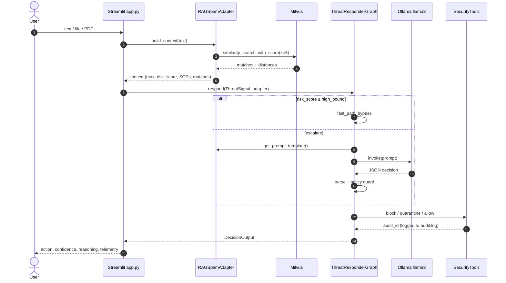

# Architecture & Flow

Diagrams are written in [Mermaid](https://mermaid.js.org/) and render natively on GitHub and in VS Code (Markdown Preview Mermaid support).

## 1. Architectural diagram

### Component summary

| Layer | Files | Responsibility |
|---|---|---|
| Entry points | `app.py`, `evals/run_evals.py` | Interactive triage UI; batch evaluation (with optional live threat-feed sync) |
| Input | `src/input_parsers.py`, PDF/OCR in `app.py`, `adapters/phishfuzzer_loader.py` | Turn raw text / files / PDFs / benchmark rows into text payloads |
| Adapter | `adapters/rag_spam_adapter.py`, `src/domain_interface.py` | Domain-specific retrieval, context building, prompt template; `DomainAdapter` contract keeps the core domain-agnostic |
| Core | `src/core.py` | LangGraph workflow, conformal routing, policy guard, audit tooling |
| Knowledge base | `scripts/*.py`, `data/milvus_threat_intel.db` | Live IOCs (OpenPhish, URLhaus), SOPs and phishing patterns embedded with `BAAI/bge-small-en-v1.5` |
| Evaluation | `evals/threat_evaluator.py`, `scripts/update_readme_results.py` | Accuracy, calibration, entropy, retrieval similarity, routing metrics |

## 2. Flow chart – decision workflow

This mirrors the LangGraph built in `ThreatResponderGraph._build_graph()`.

## 3. Sequence – one request through the system

## 4. Evaluation pipeline

```mermaid
flowchart LR
    S["sync_threat_feeds()<br/>ingest_threat_intel.py"] --> L["PhishFuzzerDatasetAdapter<br/>group-aware split,<br/>calibrated classifier"]
    L --> I["test items<br/>input + expected_action + signal_builder"]
    I --> R["RAGSpamAdapter.build_context()"]
    R --> A["ThreatResponderGraph.respond()<br/>fast path on / off"]
    A --> E["DetailedThreatEvaluator<br/>accuracy, F1, calibration error,<br/>entropy, retrieval similarity"]
    E --> C["evals/live_audit_report_*.csv"]
    C --> U["update_readme_results.py"] --> B["benchmark_results.md"]
```

